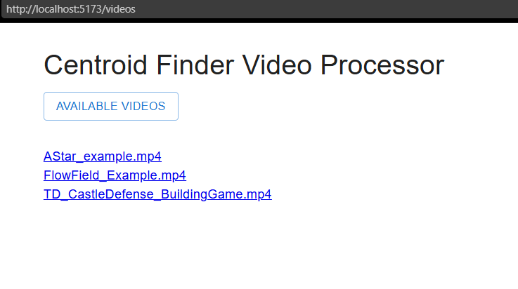
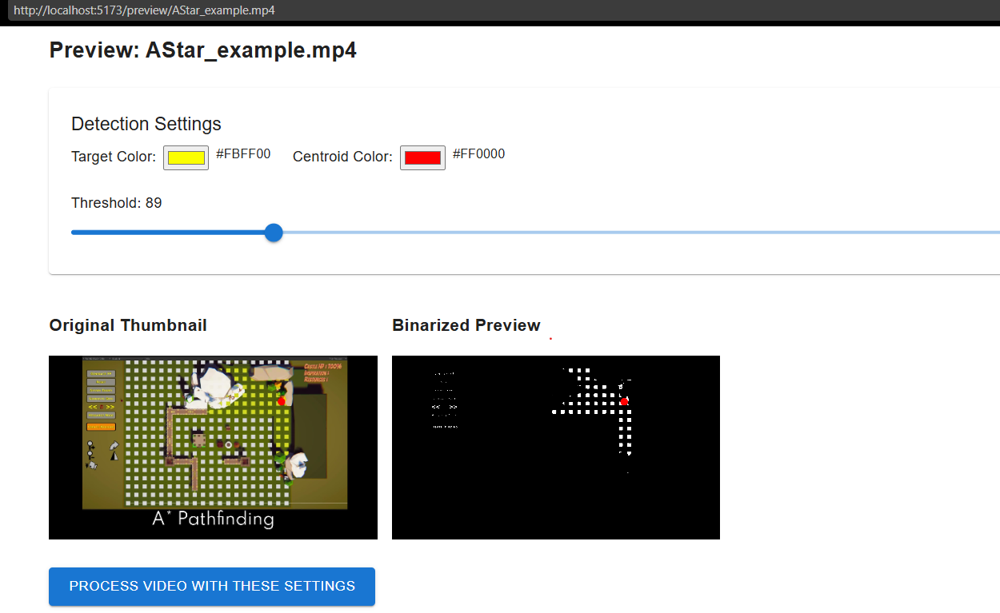
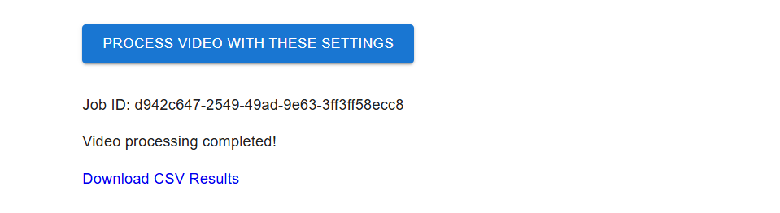

# Installation and usage

## **CLONE REPO**
><br />git clone https://github.com/KJeansGR/SDEV334-centroid-finder.git<br /><br />

<br />
<br />
<hr>
<br />
<br />
## **FRONT END**

### 1. enter the frontend directory, and basic npm install:

> cd SDEV334-centroid-finder/frontend<br /><br />
> npm install<br /><br />


### 2. Create a .env file inside the frontend directory:

><br /> VITE_API_URL=http://localhost:3000 <br /><br />


### 3. Start the development server:

><br />npm run dev <br /><br />

<br />
<hr>
<br />

## Working front end screenshots example
<div style="display: inline-flex">
    <figure>
    
    <figcaption> Video selection screen from front end </figcaption>
    </figure>
    <figure>
    
    <figcaption> Example of the video preview and live binarizer </figcaption>
    </figure>
    <figure>
    
    <figcaption> success state or a loading state will display like this below the video previews </figcaption>
    </figure>
</div>

<br />
<br />
<hr>
<br />
<br />

## **BACK END (EXPRESS SERVER)**

### 1. Enter the server directory and install dependencies:

><br />cd server<br />
>npm install<br /><br />

### 2. Create a .env file inside the server directory IMPORTANT!:

- These variables configure the server port, video directory, CSV output directory, and Java processor.
><br />PORT=3000<br />
>VIDEO_DIR=./videos<br />
>CSV_OUTPUT_DIR=./outputs<br />
>JAR_PATH=../processor/target/my-java-project-1.0-SNAPSHOT-jar-with-dependencies.jar<br /><br />


### 3. Prepare the video and output directories:

- Still within the server directory 

> <br />mkdir -p videos outputs<br />
> Place any .mp4 videos you want to process inside server/videos/.<br /><br />

### 4. Start the Express server:

> <br />npm run dev<br /><br />

```
The server should be available at:

http://localhost:3000

You can verify the server is running at:

http://localhost:3000/health
```

<br />
<br />
<hr>
<br />
<br />


## **JAVA PROCESSOR**

### 1. Build the Java processor using Maven:

- navigate to the processor folder first i use the example of "cdprocessor" here it may be different for you if you change the folder name!

> <br />cd processor<br />
> <br />mvn clean package<br /><br />

```
This compiles the Java project and creates an executable JAR with its dependencies. <br />
The generated JAR will be located at: <em>processor/target/my-java-project-1.0-SNAPSHOT-jar-with-dependencies.jar</em> <br />
```